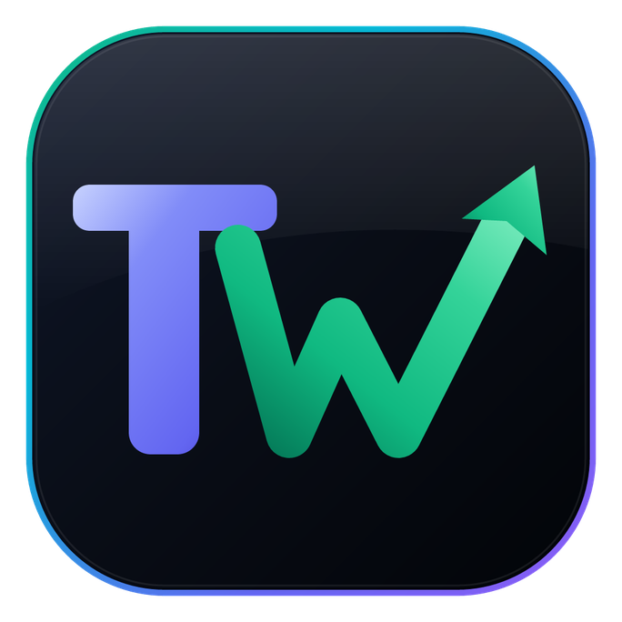

# TWCreatorCalc — The World's #1 Creator Financial Operating System & Terminal

<p align="center">
  <a href="https://twcreatorcalc.vercel.app/">
    
  </a>
</p>

<p align="center">
  <strong>Institutional-Grade Creator Financial Intelligence & Valuation Terminal</strong><br>
  <em>Calibrated for 2026/2027 Platform Monetization Algorithms</em>
</p>

<p align="center">
  <a href="https://twcreatorcalc.vercel.app/"></a>
  <a href="https://twcreatorcalc.vercel.app/"></a>
  <a href="https://twcreatorcalc.vercel.app/"></a>
  <a href="https://github.com/tawhid2005/TWCreatorCalc"></a>
</p>

---

## 🌟 Brand Identity & Logo Redesign (2026)

**TWCreatorCalc** features a clean, minimalist, high-performance vector brand identity:
* **"TW" Monogram**: Crisp architectural foundation in royal indigo (`#6366F1`), representing stability, institutional trust, and digital craftsmanship.
* **Financial Growth Surge (W + Apex Arrow)**: Dynamic ascending facets in vivid emerald and mint green (`#10B981` → `#34D399`), terminating in an on-axis 45° directional arrowhead symbolizing compounding creator revenue.
* **Obsidian Squircle Badge**: Deep slate luxury background (`#090D16`) with multi-color rim lighting and subtle top specular reflection.
* **100% Vector Scalability**: Featherweight `<2KB` SVG with instant load times, zero Cumulative Layout Shift (CLS), and pixel-perfect rendering across 16px favicons up to 4K displays.

---

## 🚀 Key Modules & Terminal Capabilities

1. **YouTube True Net Income Terminal**
   - Calculates exact creator take-home earnings post-45% Google/YouTube platform cut.
   - Dynamic RPM modeling across 12 high-paying niches and global audience geographic tiers (Tier 1 US/UK/CA to Tier 3).
2. **Sponsorship Rate Card & Contract Engine**
   - Audited valuation for 60-second video integrations, dedicated reviews, and digital usage rights.
   - Industry-standard contract clauses with anti-fraud safeguards.
3. **15.3% S-Corp vs LLC Tax Shield**
   - Compares standard Sole Proprietorship / LLC pass-through taxes against S-Corporation reasonable salary distributions.
   - Computes FICA payroll tax write-offs and tax year 2026/2027 IRS Form 1120-S filings.
4. **YouTube 2027 Algorithm Auditor**
   - Monitors threshold progression for watch hours (8,000 hrs) and Shorts views (20M).
   - Exit valuation model calibrated at 24x–36x net monthly channel cash flow.
5. **Shorts vs Long-Form 15x Revenue Reality Simulator**
   - Real-world comparisons between pooled Shorts RPM ($0.04–$0.09) and 8+ minute mid-roll AdSense cash flows.
6. **Multi-Currency Global Treasury**
   - Live real-time conversions across USD, GBP, EUR, BDT, INR, CAD, AUD, AED, SAR, and JPY.

---

## 🔍 SEO & Technical Architecture

- **Semantic HTML5 & Open Graph Standards**: Rich meta tags, Twitter Card Large Image, and Apple Web App meta tags.
- **Schema.org Structured Data**: Complete JSON-LD Graph for `WebApplication`, `Organization`, and `FAQPage`.
- **Core Web Vitals Optimized**: Zero layout shifts, native system font stacks, optimized image compression, and SVG vector favicons.
- **PWA Ready**: `manifest.json` configured with maskable high-res icons and standalone mobile display mode.

---

## 🛠️ Project Structure

```bash
TWCreatorCalc/
├── index.html           # Core YouTube Money Calculator Terminal
├── sponsorship.html     # Brand Deal Rate Card & Pricing Matrix
├── tax.html             # S-Corp vs LLC Tax Optimization Engine
├── growth.html          # Channel Valuation & Algorithm Auditor
├── analytics.html       # Shorts vs Long-Form Revenue Simulator
├── academy.html         # Creator Negotiation Scripts & CPA Guides
├── benchmarks.html      # 2026 CPM & RPM Benchmarks Directory
├── logo.svg             # Primary scalable brand vector
├── favicon.svg          # Crisp browser tab vector favicon
├── logo.png             # Official brand badge (684x684)
├── og-image.png         # OpenGraph 1200x630 Social Card
├── twitter-image.png    # Twitter 1200x630 Summary Card
├── apple-touch-icon.png # iOS Retina Home Screen Icon
├── manifest.json        # Progressive Web App Manifest
├── sitemap.xml          # Search Engine Sitemap with Images
└── robots.txt           # Crawler indexation directives
```

---

## 👨‍💻 Author & Credits

- **Founder & Lead Engineer**: [Tawhid](https://github.com/tawhid2005)
- **Studio**: **TW Digital Studio**
- **Deployment**: [Vercel](https://twcreatorcalc.vercel.app/)
